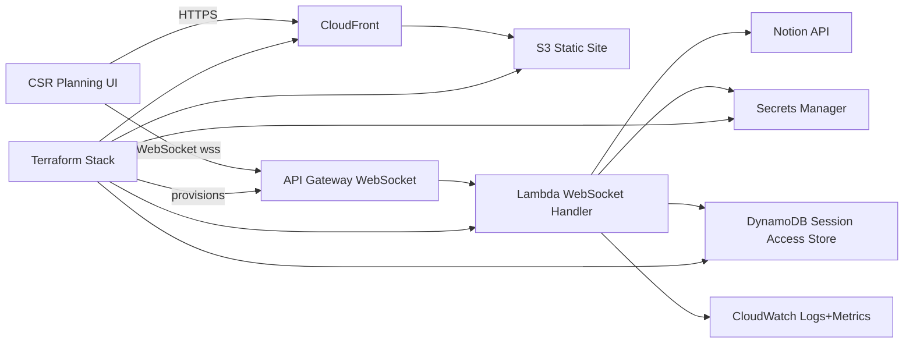
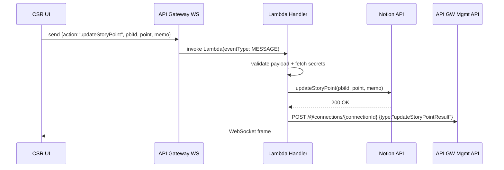
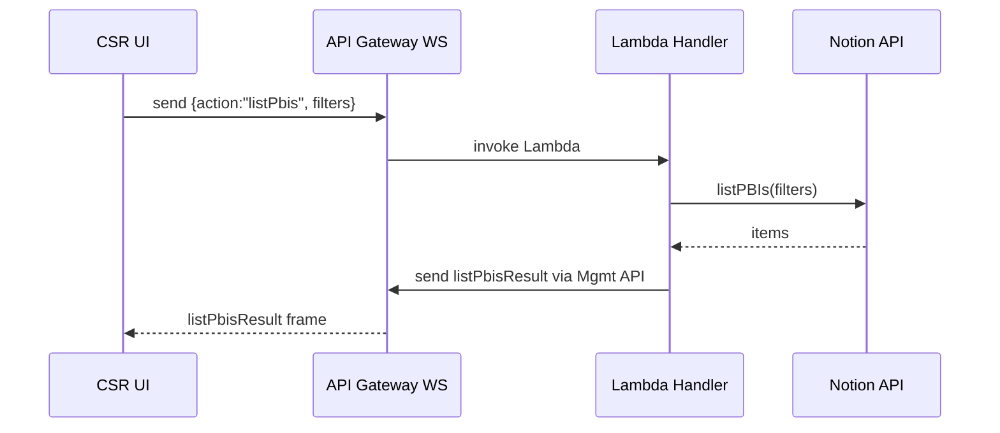
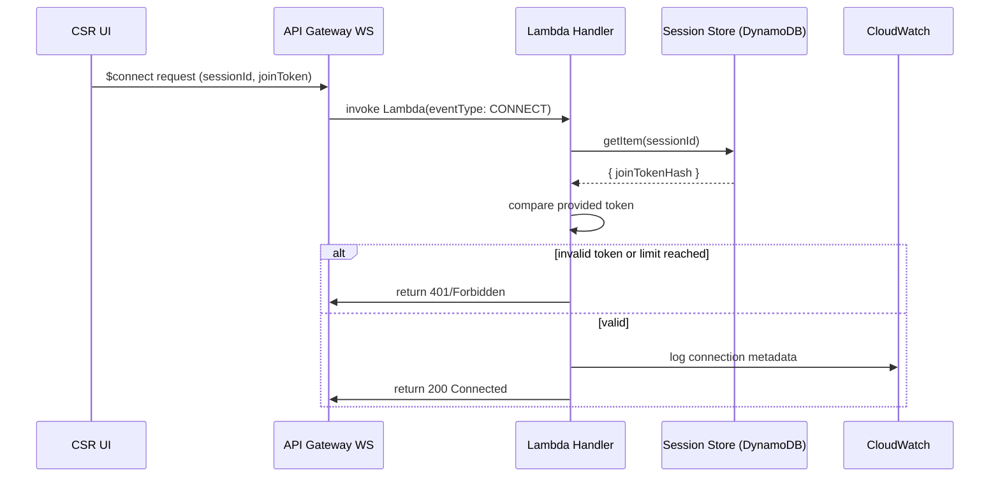

# Design Document

## Overview
本機能は serverless/ ディレクトリに存在する Lambda + API Gateway WebSocket + S3/CloudFront 構成を整備し、container/ 版と同じプランニングポーカー体験を提供する。ブラウザは CloudFront で配信される CSR Next.js を利用し、Notion データの取得とストーリーポイント更新は Lambda 1 本に集約された WebSocket ハンドラが担う。Terraform でスタック一式を構築し、Secrets Manager からのキー管理と CloudWatch ベースの監視を共通化する。

**Purpose**: Scrum チームがサーバーレス構成のみで見積もり会議を完結できるよう、リアルタイム処理と UI を AWS ネイティブに再配置する。  
**Users**: プランニングファシリテーターと参加者、並びに serverless スタックの維持を担うプラットフォームエンジニア。  
**Impact**: API Gateway WebSocket と CloudFront 配信を導入し、既存コンテナ構成と同程度の操作性・監視性・IaC をサーバーレス側に付与する。

### Goals
- Lambda WebSocket で `listPbis` / `updateStoryPoint` を Notion 安全に実行する。
- S3/CloudFront で配信する CSR UI がフィルタリング／投票ワークフローを完遂する。
- Terraform により WebSocket API・Lambda・S3・CloudFront・Secrets を一括構築し、環境差分を宣言的に管理する。

### Non-Goals
- コンテナ版リアルタイム (Socket.IO) の刷新。
- Session 管理や WebSocket アクションの追加 (例: delegate_facilitator)。
- CICD パイプラインそのものの実装 (手動/既存スクリプトを前提)。

## Architecture

### Existing Architecture Analysis
- container/ 側は App Router + Socket.IO + Redis を採用。serverless/ は Notion 連携以外の状態管理を持たず、PBI 取得と更新のみを WebSocket で完結させている。
- `@/server/notion/client` が共通ドメイン層として機能し、serverless でも alias で参照可能。環境変数基盤を Lambda でも揃える必要がある。
- 既存 serverless コードは単体テストのみで IaC は未整備。インフラ境界を Terraform で確定させることが本設計の主題。

### Architecture Pattern & Boundary Map
- **Selected pattern**: サーバレス・ヘキサゴナル (API Gateway WebSocket を入力ポート、Notion + Secrets + CloudWatch + DynamoDB を外部アダプタとする単一 Lambda コア)。
- **Boundaries**: CSR UI (静的サイト) / WebSocket API / Lambda ドメイン / Session Access Store (DynamoDB) / Notion 外部 API / IaC 管理の 6 レイヤー。UI→WebSocket→Lambda→{SessionStore, Notion} の矢印のみ許容し、接続フェーズの検証責務を SessionAccessValidator に閉じ込める。
- **Steering compliance**: TypeScript strict / 共有ドメイン / IaC 方針を維持。Terraform で serverless 専用モジュールを作成して構造の粒度を steering の「組織パターン」と揃える。

### Technology Stack
| Layer | Choice / Version | Role in Feature | Notes |
|-------|------------------|-----------------|-------|
| Frontend / CLI | Next.js 14 (CSR export), React 18, TanStack Query 5 | S3/CloudFront で配信する UI。WebSocket 接続とフィルタリング UI を提供 | `output: 'export'` を活かして静的配信 |
| Backend / Services | AWS Lambda (Node.js 18), API Gateway v2 WebSocket | WebSocket 経由で Notion 連携を処理し、レスポンスを API GW Management API 経由で送信 | 単一 Lambda に action router を内包 |
| Data / Storage | Notion API, AWS Secrets Manager | PBI データのソースとシークレット管理 | Secrets Manager から token/db id を取得 |
| Messaging / Events | API Gateway WebSocket routes (`$connect`, `$default`, `$disconnect`) | クライアントとのリアルタイム制御 | `$default` で JSON action を処理 |
| Infrastructure / Runtime | Terraform 1.7+, AWS CloudFront + S3 + IAM + CloudWatch | Serverless スタックを一元管理 | `serverless/terraform` に環境別構成 |

## System Flows

### ストーリーポイント更新フロー

- Lambda は構造化ログに sessionId/userId を含め、Notion 呼び出しの前後でメトリクスを記録する。
- 失敗時は `error` payload を送信しつつ CloudWatch に 5xx カウント。

### PBI 一覧取得フロー

### 接続検証フロー ($connect)

- Lambda は DynamoDB のアクセステーブルに保存された joinToken ハッシュを照合し、失敗時は `error` イベント送信後に接続を即座に切断する。成功時のみ `ConnectionsActive` をインクリメントし、10 接続に達していれば `error` を返す。

## Requirements Traceability
| Requirement | Summary | Components | Interfaces | Flows |
|-------------|---------|------------|------------|-------|
| Requirement 1 | Lambda WebSocket で PBI 取得/更新を処理 | ServerlessWebsocketHandler, ActionHandlers | WebSocket payload schema, NotionClient, WebsocketResponder | PBI 一覧取得, ストーリーポイント更新 |
| Requirement 2 | CSR UI でフィルタ・更新操作を実行 | CSRPlanningUI | WebSocket Hook API, UI filter state | 同上（UI 観点） |
| Requirement 3 | 環境設定と Terraform IaC | TerraformServerlessStack, SecretsManagerConfig | Terraform variables/outputs, env injection contracts | デプロイパイプライン |
| Requirement 4 | 信頼性/観測性 | MonitoringAndLoggingSuite, ServerlessWebsocketHandler | CloudWatch Logs/Metrics schema, Error payload contract | 失敗時エラーフロー |

## Components and Interfaces

### Summary Table
| Component | Domain/Layer | Intent | Req Coverage | Key Dependencies (Criticality) | Contracts |
|-----------|--------------|--------|--------------|-------------------------------|-----------|
| ServerlessWebsocketHandler | Backend Lambda | API GW からのイベントを検証し、Notion 連携へ委譲 | Req1, Req4 | NotionClient(P0), WebsocketResponder(P0), SecretsManager(P0) | `handleEvent(event, deps)`
| ActionHandlers (`handleListPbis`, `handleUpdateStoryPoint`) | Backend domain | アクションごとのビジネスロジックを実行 | Req1 | NotionClient(P0) | `ListPbisPayload`, `UpdateStoryPointPayload`
| SessionAccessValidator | Backend / Data | `$connect` 時に sessionId / joinToken / 接続数を検証 | Req1, Req4 | DynamoDB SessionAccessTable(P0), CloudWatch Metrics(P1) | `validateAccess(sessionId, joinToken): AccessDecision`
| CSRPlanningUI (Next.js export) | Frontend | フィルタ UI とイベントログ／更新フォーム | Req2 | WebSocketEndpoint(P0), TanStack Query(P1) | `usePlanningPokerSession()`
| TerraformServerlessStack | Infra | API GW / Lambda / S3 / CloudFront / Secrets Manager を構築 | Req3 | AWS Provider(P0) | `variables.tf` (tokens, domain), outputs (`ws_endpoint`, `callback_endpoint`)
| SecretsManagerConfig | Infra/Security | Notion トークンと DB ID を安全に注入 | Req3 | AWS Secrets Manager(P0) | JSON secret schema `{ notionToken, pbiDbId, sessionDbId }`
| MonitoringAndLoggingSuite | Observability | CloudWatch Logs, Metrics, アラームを構成 | Req4 | CloudWatch Logs(P0), Metrics(P1) | Log format, Metric namespace `FirePocker/Serverless`

### Backend

#### ServerlessWebsocketHandler
| Field | Detail |
|-------|--------|
| Intent | API Gateway WebSocket からの CONNECT/DISCONNECT/MESSAGE を処理し、アクションルータを実行する |
| Requirements | Requirement 1, Requirement 4 |

**Responsibilities & Constraints**
- 依存注入: `createDefaultDependencies(event)` が NotionClient, WebsocketResponder, SecretsProvider, SessionAccessValidator を渡す。
- すべてのログを `{ eventType, action?, sessionId?, connectionId }` 形式で JSON 出力。
- `$connect` では SessionAccessValidator に sessionId/joinToken を渡し、`allowed=false` の場合は `error` を返して 401 で切断。`allowed=true` の場合のみ `ConnectionsActive` を加算し、DynamoDB に状態を書き戻す。
- `$disconnect` では DynamoDB の `activeConnections` を減算し、CloudWatch Metrics (`ConnectionsActive`) を更新。
- `MESSAGE` では payload をバリデーションし、アクションごとの handler へ委譲。未知アクションへの応答は `error`。

**Dependencies**
- NotionClient: container/src/server/notion/client (P0)
- SecretsManager: AWS SDK to fetch secret/cached env (P0)
- API Gateway Management API: fetch-based responder (P0)

**Interfaces & Contracts**
- Input: `WebSocketEvent` (requestContext.eventType, connectionId, body)
- Output: WebSocket payload via `WebSocketResponder.send(connectionId, message)`
- Error contract: `{ type: 'error', message: string, code?: string }`

**Implementation Notes**
- Lambda runtime Node.js 18, bundler (esbuild) で container/src の依存を同梱。
- `WS_CALLBACK_ENDPOINT` を Terraform output から注入し、Stage を跨いだ配信を安定化。

#### ActionHandlers
| Field | Detail |
|-------|--------|
| Intent | 各アクション (`listPbis`, `updateStoryPoint`) のドメインルールをパッケージ化 |
| Requirements | Requirement 1 |

**Responsibilities & Constraints**
- `handleListPbis`: フィルタ (status/search/sprint) を検証し、`notionClient.listPBIs` を呼び出し結果を `listPbisResult` で返す。
- `handleUpdateStoryPoint`: `pbiId`, `point`, `memo` を検証。Notion 更新後 `updateStoryPointResult` を返し、CloudWatch メトリクス `StoryPointUpdates` を加算。

**Interfaces**
- `ListPbisPayload = { action:'listPbis'; status?:string; search?:string; sprint?:string }`
- `UpdateStoryPointPayload = { action:'updateStoryPoint'; pbiId:string; point:number; memo?:string }`

**Implementation Notes**
- Joi/Zod などのスキーマバリデーション導入を推奨 (型安全)。
- 例外を捕捉して `error` payload と HTTP 200 を同時に返す (API Gateway 仕様に合わせる)。

#### SessionAccessValidator
| Field | Detail |
|-------|--------|
| Intent | `$connect` フェーズで sessionId/joinToken の正当性と同時接続数を検証し、不正接続を遮断する |
| Requirements | Requirement 1, Requirement 4 |

**Responsibilities & Constraints**
- DynamoDB `SessionAccessTable` に `{ sessionId PK, joinTokenHash, maxConnections:10, activeConnections }` を保持。
- `$connect` 時に `getItem` → joinToken ハッシュ比較。失敗時は `error` で 401 を返し `ApiGatewayManagement` で切断。
- `activeConnections >= 10` の場合は `error` を返し拒否。許可時は `updateItem` で `activeConnections` をインクリメントし、`$disconnect` でデクリメント。
- 決定結果 (`AccessDecision`) を `ServerlessWebsocketHandler` に返し、ログへ sessionId/decision/code を出力。

**Interfaces**
- `AccessDecision = { allowed: boolean; reason?: 'INVALID_TOKEN' | 'LIMIT_REACHED'; sessionId: string }`
- DynamoDB schema managed via Terraform module (`session_access_table`).

**Implementation Notes**
- joinToken は container 側セッション作成時に DynamoDB へ書き込む (将来同期タスクで対応)。暫定的には管理 CLI や seed スクリプトで投入。
- ハッシュ化: `crypto.subtle.digest('SHA-256', joinToken)` の Base64 で保存し、漏洩耐性を確保。

### Frontend

#### CSRPlanningUI
| Field | Detail |
|-------|--------|
| Intent | S3 から提供される Next.js CSR ページでフィルタリング～ストーリーポイント更新 UI を提供 |
| Requirements | Requirement 2 |

**Responsibilities & Constraints**
- `usePlanningPokerSession` Hook が WebSocket 接続、イベントログ、フィルタ送信、エラー表示を担当。
- environment: `NEXT_PUBLIC_WS_ENDPOINT`, `NEXT_PUBLIC_REST_ENDPOINT` を CloudFront デプロイ時に注入。
- UI は 1ページ構成 (テーブル + 選択フォーム) を維持し、レスポンス/エラーステータスを表示。

**Interfaces**
- Hook API: `requestPbis(filters: PbiFilters)`, `updateStoryPoint(pbiId, point, memo?)`
- Data contract: `ProductBacklogItem` (import from container/src/domain/pbi)

**Implementation Notes**
- CloudFront キャッシュ無効化時にも `NEXT_PUBLIC_WS_ENDPOINT` が最新 Stage 指すように Terraform output を CI/CD へ伝搬。
- 失敗時は UI 層で CTA を無効化し `error` 文言を surfaced。

### Infrastructure

#### TerraformServerlessStack
| Field | Detail |
|-------|--------|
| Intent | serverless スタック (WebSocket API, Lambda, S3, CloudFront, Secrets) を IaC で一括管理 |
| Requirements | Requirement 3 |

**Responsibilities & Constraints**
- ディレクトリ構造: `serverless/terraform/modules/{lambda,websocket,static_site,monitoring}` + `environments/<env>`
- Variables: `region`, `stack_name`, `notion_secret_arn`, `s3_domain`, `certificate_arn`, `stage_name`
- Outputs: `ws_endpoint`, `ws_callback_endpoint`, `static_site_domain`, `session_access_table_name`
- Lambda packaging: `archive_file` or CI build artifactを参照。
 - DynamoDB: `modules/session_access_table` が PK= `sessionId` のテーブルを作成し、WCU/RCU を 5 に固定。GSI は不要だが TTL を `expiresAt` で設定可能。

**Dependencies**
- AWS Provider >= 5.0
- Data sources: `aws_acm_certificate`, `aws_route53_zone` (if needed)

**Implementation Notes**
- Remote state backend (S3/DynamoDB) を serverless 用に新設。
- S3 バケットは CloudFront Origin Access Control を採用し、public access block を有効にする。

#### SecretsManagerConfig
- Secrets Manager に JSON (notionToken, pbiDbId, sessionDbId) を保管。
- Terraform で secret を provision、Lambda IAM ロールに `secretsmanager:GetSecretValue` を付与。
- CI/CD は `terraform output secret_arn` を Lambda デプロイスクリプトへ渡し、環境変数 `NOTION_SECRET_ARN` を設定。

### Observability

#### MonitoringAndLoggingSuite
- CloudWatch Logs: JSON 形式 (`level`, `timestamp`, `eventType`, `action`, `sessionId`, `connectionId`).
- Metrics: `ConnectionsActive`, `StoryPointUpdates`, `ListPbisLatency`. `ConnectionsActive` が 10 を超えそうな時は Lambda で拒否し、CloudWatch アラームを `>=10` で通知。Lambda Powertools (optional) or自前で `PutMetricData`。
- Alarms: 5xx > 阈値, Throttles > 0, Active connections > 上限 - 5% を通知 (SNS/Slack)。

## Data Models

### Domain Model
- `ProductBacklogItem` (既存): id/title/status/storyPoint/sprint/assignee/lastEstimatedAt。
- `SessionlessActionEnvelope`: `{ action: 'listPbis' | 'updateStoryPoint'; requestId: string; payload: Record<string,unknown> }`。
- `WebSocketResponseEnvelope`: `{ type: 'listPbisResult' | 'updateStoryPointResult' | 'error'; items?; pbiId?; point?; message? }`。

### Logical Data Model
- WebSocket payloads are JSON documents validated via schema (Zod/Joi)。
- `filters` allow optional `status/search/sprint` strings; absence treated as undefined。
- `UpdateStoryPoint` requires numeric `point`; strings converted to number with NaN check。

### Data Contracts & Integration
- **Notion API**: `listPBIs(params)` uses Notion filter API. `updateStoryPoint` hits `/pages/{id}` patch.
- **Secrets**: `NOTION_SECRET_ARN` resolves to JSON. Lambda caches result between invocations。
- **Terraform outputs**: `ws_endpoint` (wss://...), `ws_callback_endpoint` (https://{apiId}.execute-api...). CSR build uses `NEXT_PUBLIC_WS_ENDPOINT=ws_endpoint`。

## Error Handling

### Strategy
- バリデーション／JSON パース: `Invalid JSON payload` 等の `error` イベントで通知。
- Notion API エラー: HTTP ステータスに応じて `error` payload (`code: 'NOTION_ERROR'`)、CloudWatch にエラー数を記録。
- Secrets 取得失敗: Lambda を失敗させ、DLQ/SNS で通知。

### Monitoring
- CloudWatch Metrics + Logs Insights クエリで eventType/action 毎に分析。
- API Gateway Access Log でコネクション数を追跡。

## Testing Strategy
- **Unit**: `handleEvent` (CONNECT/DISCONNECT/MESSAGE), `handleListPbis`, `handleUpdateStoryPoint`, Secrets fetch fallback, WebsocketResponder。
- **Integration**: Terraform plan (infrastructure drift), Lambda + LocalStack テスト、CSR UI ↔ mocked WebSocket。
- **E2E**: `pnpm dev:serverless` + Cypress/Playwright でフィルター操作～更新を確認。
- **Performance**: Artillery/K6 で 1k 同時 WebSocket 接続、Notion API モック応答を用いたレイテンシ測定。

## Security Considerations
- Secrets Manager で Notion token/db id を暗号化、Lambda IAM ロールに最小権限を付与。
- API Gateway には WSS + TLS のみ許可。CloudFront も ACM 証明書を使用。
- WebSocket 接続は joinToken/sessionId を payload 前提 (要検証) とし、不正アクセスはストール。

## Performance & Scalability
- Lambda provisioned concurrency optional (prod) で cold start 影響を軽減。
- API Gateway WebSocket concurrency limit を Terraform で Stage ごとに調整。
- CloudFront キャッシュ TTL を短め (1m) に設定し、UI 配信を高速化。

## Supporting References
- `.kiro/specs/serverless-functional-parity/research.md`
- `serverless/src/websocketHandler.ts`
- `serverless/web/app/page.tsx`
- `serverless/web/src/hooks/usePlanningPokerSession.tsx`
- `container/terraform/README.md`
