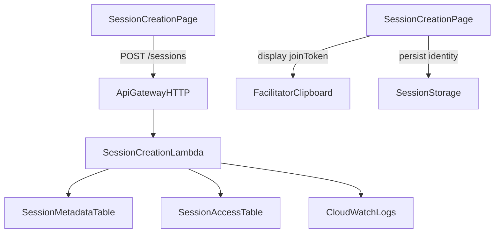
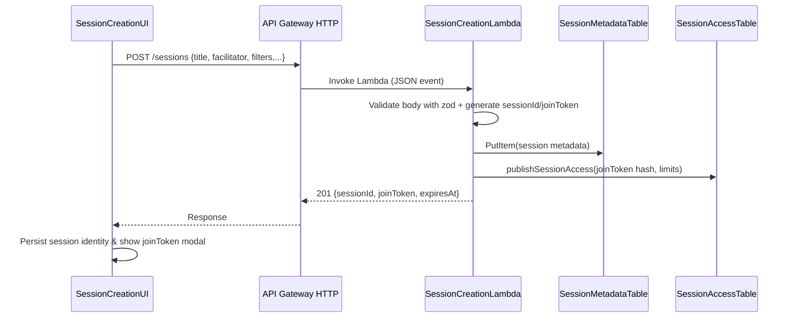

# Design Document

## Overview
本機能は serverless スタックに「セッション作成」経路を追加し、ファシリテーターがブラウザからセッションを登録・joinToken を取得できるようにする。これにより container 版と同等のワークフローを serverless 単体でも完結させ、WebSocket 接続前の準備作業をサーバーレス側で閉じる。

**Purpose**: Serverless Session Creation はファシリテーターに対して HTTP API + CSR ページを提供し、sessionId/joinToken 生成と SessionAccess 連携を完了させる。
**Users**: ファシリテーター（セッション作成）、プラットフォーム管理者（接続上限・公開設定）、参加者（joinToken 受領後に WebSocket へ参加）。
**Impact**: 既存 serverless web は参照専用だったが、本機能により「作成 → 共有 → 参加」の一連を serverless のみで実践できる。SessionAccess/DynamoDB にメタデータが加わり、監視・監査ログも追加される。

### Goals
- 要件 1〜4 で定義したセッション作成・joinToken 発行・アクセス制御・UI 体験を serverless で再現する。
- CSR ページから API Gateway HTTP 経由で Lambda を呼び出し、DynamoDB へメタデータと joinToken 情報を保存する。
- 生成した sessionId/joinToken を UI で提示し、`persistSessionIdentity` へ保存して WebSocket 接続へ遷移できる状態にする。

### Non-Goals
- 既存 WebSocket メッセージ（listPbis, updateStoryPoint）の刷新や Notion スキーマ変更。
- セッション一覧管理画面や監視 UI（本フェーズでは API + Dynamo まで）。
- joinToken の多要素認証や OAuth 連携など高度な認可機能。

## Architecture

### Existing Architecture Analysis
- container 版では `/api/sessions` → `createSession` が sessionId/joinToken を発行し、`publishSessionAccess` で DynamoDB (SessionAccess) を更新。UI は `persistSessionIdentity` で sessionStorage に保持する。
- serverless 版は API Gateway WebSocket + Lambda のみで、接続検証は既存 SessionAccessValidator（Dynamo を参照）に委譲されている。HTTP API は未導入。
- Terraform はモジュール化されており、Lambda を追加する場合は `modules/websocket_lambda` と同等の構造で組める。CSR は `NEXT_PUBLIC_WS_ENDPOINT` しか参照していないため、REST 用に `NEXT_PUBLIC_REST_ENDPOINT` を導入する必要がある。

### Architecture Pattern & Boundary Map
選択パターン: サーバーレス分離境界 (API Gateway HTTP + Lambda) を UI・Domain・Persistence で分割。WebSocket 層とは SessionAccess を通じて疎結合とし、Hexagonal に近い構成（UI→API→Domain→Adapter）。



- **Domain/Boundary**: UI (Next.js CSR), Application (SessionCreationLambda), Infrastructure (SessionMetadata Dynamo, SessionAccess store, CloudWatch)。
- **Existing patterns preserved**: `publishSessionAccess` を共通ドメインとして流用、`NEXT_PUBLIC_*` で環境注入。
- **New components rationale**: HTTP Lambda でフォーム POST を処理し、`SessionMetadataTable` で UI に必要な context を保持する。
- **Steering compliance**: TypeScript strict、疎結合、IaC での宣言管理を維持。

### Technology Stack
| Layer | Choice / Version | Role in Feature | Notes |
|-------|------------------|-----------------|-------|
| Frontend / CLI | Next.js 14 CSR (`serverless/web`) + React Hook Form/自前 state | セッション作成画面と joinToken 表示 | 既存 `serverless/web` にページ追加 |
| Backend / Services | AWS Lambda (Node.js 18) + TypeScript + zod | `POST /sessions` リクエストの検証とドメイン処理 | `@/*` エイリアスで container ドメインを再利用 |
| Data / Storage | DynamoDB SessionMetadata (新規), 既存 SessionAccess テーブル | メタ情報と joinToken ハッシュの保存 | SessionMetadata は PK=sessionId, TTL=expiresAt |
| Messaging / Events | CloudWatch Logs + Metrics | 監査ログとメトリクス（SessionCreated, TokenIssued） | 既存ログルールに準拠 |
| Infrastructure / Runtime | API Gateway HTTP API, Terraform module for Lambda/HTTP | CSR からの REST 呼び出しを受け付ける新経路 | Terraform に module を追加し outputs 連携 |

## System Flows

- DynamoDB への書き込みは `TransactWriteItems` で SessionMetadata + SessionAccess を一括更新し、不整合を防ぐ。
- UI はレスポンス受領後に `persistSessionIdentity` を呼び出し、joinToken を提示して WebSocket ページへ誘導する。

## Requirements Traceability
| Requirement | Summary | Components | Interfaces | Flows |
|-------------|---------|------------|------------|-------|
| 1.1–1.4 | セッション作成フォーム | SessionCreationPage, SessionCreationLambda | POST /sessions, `SessionMetadataStore` | Session creation sequence |
| 2.1–2.5 | joinToken 発行・提示・再発行 | SessionCreationLambda, SessionCreationPage | `publishSessionAccess`, UI modal | Sequence後半 |
| 3.1–3.5 | 接続上限・有効期限・公開設定 | SessionCreationLambda, SessionMetadataStore | Dynamo Transaction, Structured logs | Sequence + logging |
| 4.1–4.5 | UI 体験とフィードバック | SessionCreationPage, SessionCreationFormStore | `persistSessionIdentity`, clipboard | UI flow |

## Components and Interfaces

### コンポーネントサマリー
| Component | Domain/Layer | Intent | Requirements | Dependencies (P0/P1) | Contracts |
|-----------|--------------|--------|--------------|-----------------------|-----------|
| SessionCreationPage | UI | 作成フォームと joinToken 提示 | 1.*, 4.* | SessionCreationAPI(P0), SessionIdentityStorage(P1) | REST `/sessions` |
| SessionCreationFormStore | UI | 入力 state/validation 管理 | 1.*, 4.* | zod schema(P1) | Hook props/state |
| SessionCreationLambda | Backend | HTTP リクエスト処理とドメイン呼び出し | 1.*, 2.*, 3.* | SessionMetadataStore(P0), publishSessionAccess(P0) | Lambda handler signature |
| SessionMetadataStore | Data | DynamoDB CRUD + TTL 管理 | 3.*, 1.4 | AWS SDK (DocumentClient)(P0) | `putMetadata(SessionRecord)` |
| SessionCreationContracts | Shared | DTO/バリデーション定義 | 全体 | zod, TypeScript types(P0) | Request/Response schema |

### UI Layer

#### SessionCreationPage
| Field | Detail |
|-------|--------|
| Intent | UI でタイトル・ホスト名・バックログフィルターを入力し、作成リクエストを発行する |
| Requirements | 1.1–1.4, 2.4, 4.* |

**Responsibilities & Constraints**
- Form fields: `title`, `hostName`, `backlogSource`（Notion DB ID／ saved filter）、`connectionCap`, `publicView`。
- 送信中はボタン無効化・スピナー表示、成功時は joinToken モーダル表示、失敗時はエラーバナー。
- `persistSessionIdentity` を呼び、`buildSessionEntryPath` で遷移 URL を作成。

**Interfaces**
- Props: なし（ページコンポーネント）。
- REST 呼び出し: `POST ${process.env.NEXT_PUBLIC_REST_ENDPOINT}/sessions` with `CreateSessionRequest`。
- Callback: `onSuccess({ sessionId, joinToken })` でコピー＆遷移。

**Implementation Notes**
- `useTransition` もしくは独自 `isSubmitting` state で二重送信防止。
- joinToken 表示は一度のみ。`copyToClipboard` 失敗時は toast で案内。

#### SessionCreationFormStore
| Field | Detail |
|-------|--------|
| Intent | zod スキーマに基づく入力値の管理とエラーメッセージ整形 |
| Requirements | 1.1, 2.5, 4.* |

**Responsibilities**
- `useReducer` でフォーム値を集中管理し、`validate()` で zod から field-level エラーを取得。
- 直近の入力を localStorage (optional) に保存し、Requirement 4.5 の「前回設定再利用」をサポート。

### Backend Layer

#### SessionCreationLambda
| Field | Detail |
|-------|--------|
| Intent | HTTP POST を受信し、バリデーション・ID 生成・Dynamo 更新・joinToken 応答を担う |
| Requirements | 1.*, 2.*, 3.* |

**Responsibilities & Constraints**
- `zod` スキーマ (`SessionCreationContracts`) で Request を検証し、`generateSessionId`/`generateJoinToken` を呼ぶ。
- `TransactWriteItems` で SessionMetadata + SessionAccess (publishSessionAccess) を同時に更新。
- 監査ログ: CloudWatch へ JSON（sessionId, facilitator, maxConnections, result）。
- エラー → HTTP status + エラーメッセージ JSON。

**Interfaces**
- Input: API Gateway HTTP event (JSON body)。
- Output: `201` レスポンス `{ sessionId, joinToken, expiresAt }`。
- Dependencies: `SessionMetadataStore.put(record)`, `publishSessionAccess({sessionId, joinToken, maxConnections, expiresAt})`。

**Implementation Notes**
- 失敗時に `publishSessionAccess` のみ成功するケースを避けるため、`TransactWriteItems` で Dynamo 操作をまとめる。publishSessionAccess も Dynamo を利用するため、Store を拡張して transaction 対応ユーティリティを実装。
- `MAX_CONNECTIONS` は入力値 or `process.env.SESSION_ACCESS_MAX_CONNECTIONS`。

#### SessionMetadataStore
| Field | Detail |
|-------|--------|
| Intent | DynamoDB テーブル `session_metadata` のラッパー。タイトルや facilitator 情報を保存し、TTL を設定する |
| Requirements | 3.1–3.4, 1.4 |

**Responsibilities**
- `putMetadata(SessionMetadataRecord)` で TTL 付き PutItem。
- `getMetadata(sessionId)` は将来の UI/監査用に提供（今回の要件外だが API テストで利用）。
- Validations: expiresAt が現在時刻より未来であることを保証。

**Implementation Notes**
- `SessionMetadataRecord` 型: `{ sessionId, title, facilitatorId, facilitatorName, backlogSource, connectionCap, createdAt, expiresAt, publicViewEnabled }`。
- Dynamo キー: `PK=sessionId`、LSI/secondary index は未設定（将来追加）。

### Shared / Domain

#### SessionCreationContracts
| Field | Detail |
|-------|--------|
| Intent | Request/Response DTO、zod スキーマ、TypeScript 型を定義し UI と Lambda で共有 |
| Requirements | 1.*, 4.* |

**Responsibilities**
- `CreateSessionRequest` 型: `{ title: string; facilitator: { id: string; name: string }; backlogSource?: { notionDbId?: string; filter?: string }; connectionCap?: number; publicView?: boolean; expiresAt?: string }`。
- `CreateSessionResponse` 型: `{ sessionId: string; joinToken: string; expiresAt: string }`。
- Validation errors を UI へ返す際、`issues: { field: string; message: string }[]` を定義。

## Data Models

### Domain Model
- **SessionMetadata Aggregate**
  - `sessionId`: string (自然キー)
  - `title`: string
  - `facilitatorId`: string
  - `facilitatorName`: string
  - `backlogSource`: object `{ type: 'notion'; notionDbId?: string; filter?: string }`
  - `connectionCap`: number
  - `publicView`: boolean
  - `createdAt`: ISO string
  - `expiresAt`: epoch ms (TTL)

### Logical Data Model
- DynamoDB `session_metadata`
  - PK: `sessionId` (HASH)
  - Attributes: 上記ドメインフィールド + `lastUpdatedAt`
  - TTL: `expiresAt`
  - Access pattern: `GetItem(sessionId)`、`PutItem`
- SessionAccess テーブル (既存): 変更なし。`publishSessionAccess` で `maxConnections`/`joinTokenHash`/`expiresAt` を保存。

### Data Contracts & Integration
- **HTTP Request Schema** (JSON):
  ```json
  {
    "title": "スプリント見積もり",
    "facilitator": { "id": "host_12345678", "name": "山田太郎" },
    "backlogSource": { "notionDbId": "xxx", "filter": "status=Ready" },
    "connectionCap": 15,
    "publicView": false
  }
  ```
- **HTTP Response Schema**:
  ```json
  {
    "sessionId": "sess_xxx",
    "joinToken": "abcd-1234...",
    "expiresAt": "2025-12-01T12:00:00Z"
  }
  ```
- **Error Schema**: `{ "code": "ValidationError", "message": "hostName is required", "issues": [...] }`

## Error Handling

### Error Strategy
- Lambda はバリデーション失敗を 400、業務ルール違反（期限が過去など）を 422、内部エラーを 500 で返す。
- UI はフィールドエラーをハイライトし、未指定エラーはバナー表示。

### Error Categories and Responses
- **User Errors (4xx)**: 欠落入力、過去日 TTL → `issues` 配列を返し UI で表示。
- **System Errors (5xx)**: Dynamo/Notion エラー → CloudWatch に詳細を記録し、UI にはリトライ案内。
- **Business Logic Errors (422)**: 接続上限が0以下など → 明示的メッセージ。
- **Monitoring**: Lambda Powertools logger で `SESSION_ID`, `JOIN_TOKEN_HASH` を含まない構造化ログ、CloudWatch メトリクス `SessionsCreated`, `SessionCreationErrors` を記録。

## Testing Strategy
- **Unit Tests**
  - `SessionCreationLambda` バリデーション: 正常系/必須欠落/無効 TTL。
  - `SessionMetadataStore.putMetadata` が TTL・属性を正しく書き込むこと。
  - `SessionCreationContracts` zod スキーマ: 任意フィールドの扱い。
- **Integration Tests**
  - Lambda handler をモック DocumentClient で実行し、TransactWriteItems が呼ばれること。
  - UI hook + fetch モックで 201 応答を処理し、`persistSessionIdentity` が実行されること。
  - Terraform module に HTTP API + Lambda + Dynamo リソースが追加されていること (vitest / terraformModules.test.ts 拡張)。
- **E2E/UI Tests**
  - Playwright でフォーム入力→成功→joinToken コピーを確認。
  - フィールド未入力時のエラーメッセージ表示。

## Security Considerations
- API Gateway HTTP には CORS 制限 (serverless/web の Origin のみ) と Usage Plan/API Key を設定し、不正作成を抑止。
- joinToken はレスポンスのみ平文で返し、Dynamo にはハッシュ値のみ保存。
- CloudWatch ログには joinToken 平文を出力しない。
- 連続リクエスト対策として `connectionCap` と `publicView` の組み合わせに制限を設ける (例: 一定以上の公開セッションは承認制)。

## Performance & Scalability
- Lambda は 128MB/3秒で十分。大量リクエスト時は Dynamo をボトルネックとするため、`TransactWriteItems` のリトライ処理を実装。
- API Gateway HTTP のレート制限を Usage Plan で設定 (例: 50req/s)。
- UI からのリクエストは 1 人 1 回程度なので特別なキャッシュは不要。

## Supporting References
- 詳細な調査と意思決定は `.kiro/specs/serverless-session-creation/research.md` を参照。
